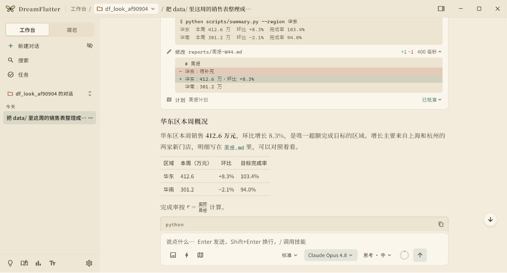
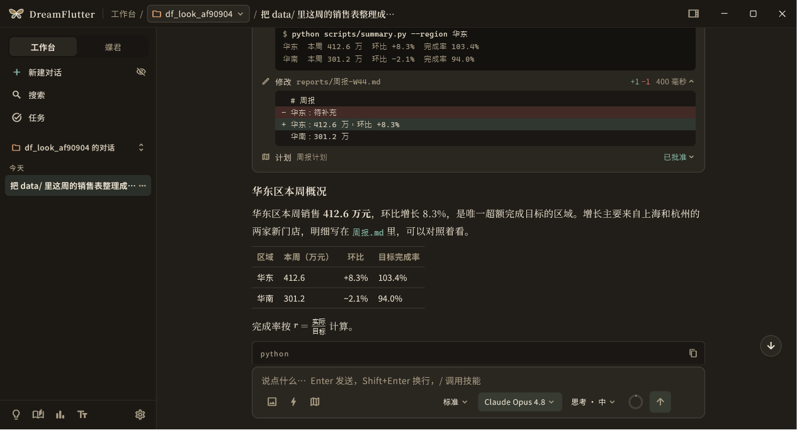
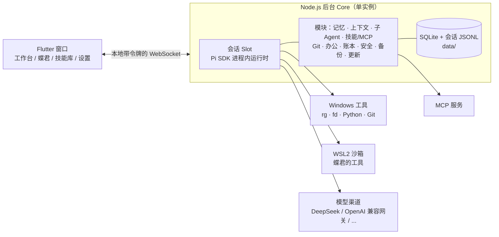

<p align="center">
  
</p>

<h1 align="center">DreamFlutter · 梦蝶</h1>

<p align="center">
  一个住在你电脑里的个人 AI Agent 平台：<br>
  <b>工作台</b>陪你在本机项目里干活，<b>蝶君</b>在自己的沙箱里独立工作、慢慢成长。
</p>

<p align="center">
  
  
  
  
  
</p>

> **English in one paragraph** — DreamFlutter is a local-first personal AI agent platform for Windows. A Flutter desktop shell talks to a Node.js core that hosts many [Pi](https://www.npmjs.com/package/@earendil-works/pi-coding-agent) agent sessions in-process. It has two spaces: the **Workbench**, which works with you on your own folders under per-action approval, and **Diejun** ("Lord Butterfly"), an agent that runs on its own inside a WSL2 sandbox. Beyond that it has a three-tier long-term memory, context compaction, sub-agents, skills and MCP that the agent can find, build, test and register itself, built-in Office/PDF/data tooling, a Git service, a per-request cost ledger, sandboxed security boundaries, backups and rollback-safe updates. Bring your own model keys (DeepSeek, OpenAI-compatible gateways, and more).

<p align="center">
  
  
</p>

## 为什么做它

现在的 AI 助手大多住在网页里：聊完就散，记不住你，碰不到你的文件，也说不清钱花在哪儿。DreamFlutter 想做的是一个**装在自己电脑上、数据归自己、能长期合作**的 Agent：

- **本机优先**：会话原文、记忆、设置、账本都放在软件旁边的 `data/` 目录，可备份、可搬迁、可恢复；模型密钥由你自己提供，本机加密保存。
- **两种协作关系**：工作台在你的项目里动手，敏感操作要你点头；蝶君在隔离的 WSL 沙箱里自己干活，弄坏了也碰不到你的系统。
- **说得清楚**：每次模型请求都记账（金额标明是实际、估算还是缺失）；记忆的每次写入、修改、遗忘都有日志，能撤销。
- **能自己长本事**：你说"帮我做一个 X 技能""接上 X 服务"，Agent 会先找成熟方案，必要时自己写，在沙箱里测过，再交给你确认启用。

## 主要能力

| 方向 | 能做什么 |
|---|---|
| **Agent 运行时** | 后台进程内托管多个 Pi 会话，多会话并行，关掉窗口也能继续跑；流式思考和工具卡片；运行中插话、停止；Agent 主动提问（限时后选推荐项）；派"通用""调研员"子 Agent，最多 4 个并行，花费计入本次运行 |
| **工作台 / 蝶君** | 工作台的工具在 Windows 本机执行，自带 rg、fd、uv 和便携 Python；蝶君的工具在 WSL2 沙箱里执行，沙箱镜像离线随包，不给 root，网络可开可关，带 11 项逃逸自检 |
| **记忆与上下文** | 三级记忆（短期观察 → 稳定事实 → 长期原则），程序按时间和证据升降级；到期、反例推翻、矛盾预筛、周期复查；全局记忆和工作区记忆分开；按任务组装记忆快照；用到 85% 时提前在后台准备压缩，防止已失效的事实复活 |
| **会话关系** | 分叉、复制、回收站；对选中文字开侧边对话，不污染主对话，可保存、可带回；无痕对话不落盘 |
| **技能与 MCP（v0.7）** | 技能、任务模板、MCP 服务统一管理，带来源、启用状态、使用次数；内置总路由、建技能、建 MCP 三个基础技能；社区导入的技能和服务默认不信任，确认后才加载；技能脚本在蝶君沙箱里试运行；蝶君能用哪个 MCP 要按服务单独授权 |
| **办公与数据（v0.7）** | 随包带好 docx、openpyxl、pptx、pypdf、pandas、matplotlib，并配内置技能：Word/Excel/PPT/PDF 读写、PDF 合并拆分、表格批量处理、中文图表；本机装了 Microsoft Office 时，还能把 Office 文档转成 PDF、把旧格式转成新格式（没装就明确告诉你转不了）；`showcard-pro` 技能把周报这类交付做成排版好的卡片和文章 |
| **Git（v0.7）** | 后台 Git 服务和 Agent 工具：状态、差异、暂存提交、分支、历史、撤销，撤销前自动留恢复点；读操作直接做，写操作按工作台审批规则；随包带官方 MinGit，没装 Git 的机器也能用 |
| **模型与渠道** | 多渠道、多模型组；思考档位和上下文窗口跟着模型走；从 Pi 和 cc-switch 自动迁移配置；联网搜索和网页抓取（用你自己的 DeepSeek 密钥，或在本机抓取） |
| **费用与用量** | 逐请求账本，按用途分开记（主对话、子 Agent、记忆、压缩、标题、看图、搜索）；账户余额、供应商套餐用量、本机估算分开显示 |
| **安全** | 工具调用三档审批；敏感路径分"拒绝 / 需确认 / 允许"三类；PowerShell 命令保守判断；日志和诊断脱敏；MCP 本地服务以最小环境启动；本地审计日志保留 90 天 |
| **数据、备份与更新** | 全平台备份、迁移、恢复；按类别搬迁数据位置，失败自动退回；磁盘快满时暂停写入；Velopack 更新，更新前做一致性备份，新版本验证不过就自动回到旧版本并恢复数据 |
| **外观** | 文学、极简的界面语言；橙色蝴蝶标志的 1:1 矢量复刻，颜色随"名画主题"变化，深色主题自动换白色轮廓线 |

## 架构



| 目录 | 内容 |
|---|---|
| [`core/`](core) | 后台服务（TypeScript，Node 22 直接运行）。入口 `src/main.ts`，模块装配 `src/app.ts` |
| [`app/`](app) | Flutter Windows 窗口 |
| [`packages/pi_rpc/`](packages/pi_rpc) | 窗口和后台之间的 Core/Slot 通道、消息折叠（纯 Dart，可单独测试） |
| [`packages/desktop_drop/`](packages/desktop_drop) | 带 Windows 拖图修补的插件 |
| [`core/assets/skills/`](core/assets/skills) | 内置技能：总路由、建技能、建 MCP、办公四件套、数据分析、showcard-pro |
| [`scripts/`](scripts) | 打包（`package-windows.ps1`）、体积统计、第三方许可生成和各版本的验证脚本 |
| [`docs/`](docs) | 设计、路线图、接口说明、发布说明、测试场景 |

## 当前进度

| 版本 | 主题 | 状态 |
|---|---|---|
| v0.1 – v0.2 | Pi 原生运行时接入、多会话、审批、网关、多模态 | ✅ 已完成 |
| v0.3.x | 执行环境、Agent 运行时、子 Agent、蝶君骨架、WSL 沙箱、全平台备份 | ✅ 已完成 |
| v0.4 | 外壳与呈现：新窗口框架、详情栏、侧边对话、品牌与名画主题 | ✅ 已完成 |
| v0.5 | 三级记忆、上下文服务与压缩、会话关系 | ✅ [v0.5.0](docs/releases/v0.5.0.md) |
| v0.6 | 模型与渠道、安全设置、数据与存储、联网搜索、逐请求账本、更新与回滚、包体瘦身 | ✅ [v0.6.0](docs/releases/v0.6.0.md) |
| **v0.7** | **技能与 MCP 体系、内置办公与数据处理、Git 服务** | 🧪 候选 `0.7.0-test.3` 联合验收已通过，用户实测中 |
| v0.8 – v0.9 | 长任务与目标、蝶君自主与成长 | 规划中 |
| v0.10 – v0.12 | 接口文档、前端阶段、打磨与深度测试 | 规划中 |
| v1.0 | 正式版和安装包 | 规划中 |

完整计划见 [roadmap](docs/roadmap.md)。**正式安装包等 V1.0 再发布**，在那之前仓库里的版本标签都是源码节点。

## 怎么开发出来的：多个 Agent 协作

这个项目本身就是一次人和多个 AI Agent 的长期协作：

- **用户**：提需求、定产品决策、亲自做每个版本的安装实测。
- **Claude**：设计、写大部分代码、复核和验收，把版本拆成编号任务派给执行窗口。
- **Codex**：多个并行的执行窗口，按任务卡实现、跑门禁、留证据。
- **Antigravity**：做调研（官方规范、社区方案、体积实测）。

每个版本都走同一套流程：调研 → 决定备忘 → 分波派工 → 执行窗口施工 → 冻结源码 → 串行全量门禁 → 少量付费真实模型冒烟 → 正式流程打候选包 → 在没有开发环境的干净机器上验证 → 用户按清单实测 → 发布说明里写清楚已知限制。以 v0.6 为例：后台 480 项、Flutter 179 项、协议层 52 项测试全部通过，另有 11 项干净环境验证和真实更新回滚演练。

相关文档：[开发规范](docs/dev-guide.md) · [全场景测试清单](docs/testing/scenarios.md) · [v1.0 收敛说明](docs/v1.0-convergence.md) · [交接文档](docs/HANDOFF.md)

## 从源码运行

需要：Windows 10/11、Node.js ≥ 22.19、Flutter 3.47+、Visual Studio 2022 生成工具（C++ 桌面工作负载），并开启 Windows "开发人员模式"。蝶君沙箱另需 WSL2。

```powershell
# 后台
cd core
npm ci
npm test
npm run typecheck

# 窗口
cd ../app
flutter pub get
flutter test test
flutter analyze
flutter run -d windows
```

协议层：进入 `packages/pi_rpc`，先 `dart pub get`，再 `dart test -x integration`。打包分发版用 `scripts/package-windows.ps1`（输出到 `dist/`，随附 Node、搜索工具、便携 Python、离线沙箱镜像和 MinGit，资产准备方式见脚本开头）。第一次启动后在设置里添加你自己的模型渠道和密钥。

## 文档导航

- 设计：[架构](docs/architecture.md) · [记忆设计](docs/memory-design.md) · [长任务设计](docs/long-task-design.md) · [安全](docs/security.md) · [Agent 模式](docs/agent-modes.md) · [设计语言](docs/design/design-language.md) · [品牌](docs/design/brand.md)
- 接口：[记忆与上下文](docs/memory-context-api.md) · [会话关系](docs/session-relationships.md) · [联网搜索](docs/web-search-api.md) · [逐请求账本](docs/request-ledger-api.md) · [软件源](docs/package-sources-api.md) · [更新](docs/updates-api.md)
- 调研：[`docs/research/`](docs/research)（v0.7：[技能与 MCP](docs/research/v0.7-r1-skills-mcp.md) · [路由](docs/research/v0.7-r2-routing.md) · [办公库体积](docs/research/v0.7-r3-office-footprint.md) · [Git](docs/research/v0.7-r4-git.md) · [决定备忘](docs/research/v0.7-decision-memo.md)）
- 发布：[`docs/releases/`](docs/releases) · [v0.7 用户实测清单](docs/testing/v0.7-user-checklist.md)

## 致谢

- [Pi](https://www.npmjs.com/package/@earendil-works/pi-coding-agent)（`@earendil-works/pi-coding-agent` / `pi-ai` / `pi-mcp`）：Agent 运行时
- [Flutter](https://flutter.dev)、[Velopack](https://velopack.io)、[MinGit](https://github.com/git-for-windows/git)，以及随包分发的第三方组件（应用"关于"页列出全部许可）
- 管理页参考了 RikkaHub 的技能 / MCP 设计；展示技能基于 Showcard

---

<p align="center"><sub>庄周梦蝶，不知周之梦为蝴蝶与，蝴蝶之梦为周与。</sub></p>
