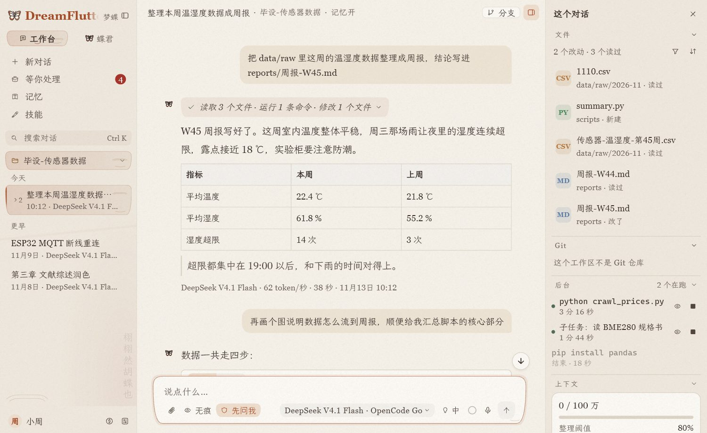
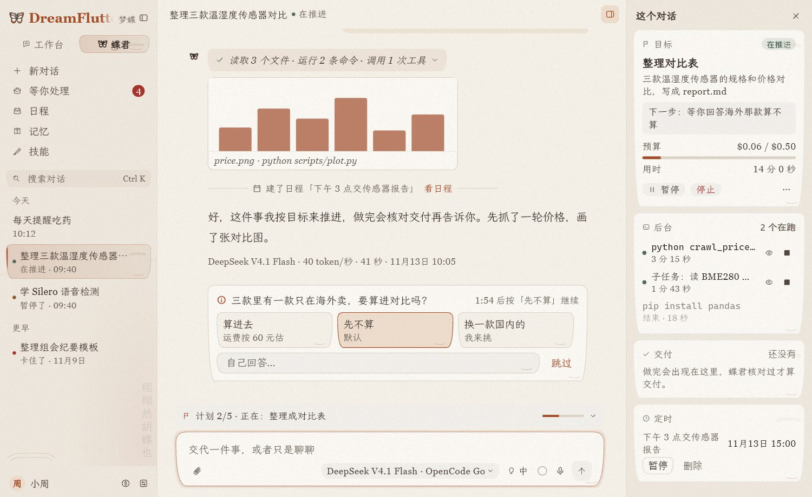
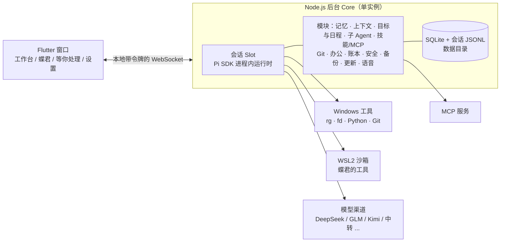

<p align="center">
  
</p>

<h1 align="center">DreamFlutter · 梦蝶</h1>

<p align="center">
  一个住在你电脑里的个人 AI Agent 平台：<br>
  <b>工作台</b>陪你在本机文件夹里干活，<b>蝶君</b>在自己的沙箱里独立工作、慢慢成长。
</p>

<p align="center">
  
  
  
  
  
</p>

> **English in one paragraph** — DreamFlutter is a local-first personal AI agent platform for Windows. A Flutter desktop shell talks to a Node.js core that hosts many [Pi](https://www.npmjs.com/package/@earendil-works/pi-coding-agent) agent sessions in-process. It has two spaces: the **Workbench**, which works with you on your own folders under per-action approval, and **Diejun** ("Lord Butterfly"), an agent that runs on its own inside a WSL2 sandbox that the app sets up for you. Beyond that it has a three-tier long-term memory, context compaction, sub-agents, long-running goals and schedules, skills and MCP that the agent can find, build, test and register itself, built-in Office/PDF/data tooling, a Git service, a per-request cost ledger, backups and rollback-safe updates. A five-lesson, follow-along tutorial in the real window gets people with no agent experience started. Bring your own model keys (DeepSeek, GLM, Kimi, MiniMax, OpenCode Go, or any OpenAI/Anthropic-compatible relay). **1.0 preview** — friends' beta in progress.

<p align="center">
  
  
</p>

## 下载安装

**1.0 预览版**：到 [Releases](https://github.com/jun64349/DreamFlutter/releases) 下载 `DreamFlutter-Installer.exe`（约 260 MB）。

1. 双击安装器，选一个安装位置（默认在你的用户目录下，不需要管理员权限），装好约 660 MB。
2. 第一次打开是设置向导：起个称呼、选数据放哪儿、接上一个模型（推荐 DeepSeek，便宜，国内能直接用；需要你自己在模型公司拿一个密钥）。
3. 左下角的「入门 5 课」会手把手带你走一遍：在真界面里压暗其余地方、只亮要点的那一处，做完自动进下一步，大约 45 分钟。十课图文课本在 设置 › 关于与更新 › 使用说明，也可以在仓库里读：[docs/guide](docs/guide/README.md)。
4. 想用蝶君时点「建立沙箱」：没有 WSL 的电脑由程序弹管理员确认后代装，可能要重启一次，重启后自动接着建；系统镜像第一次用时下载（约 650 MB）。本机语音识别的模型也是第一次用到时才下载（约 230 MB）。

之后的新版本在程序里自动下载、更新，更新前会备份，新版本起不来就自动退回旧版本。

## 为什么做它

现在的 AI 助手大多住在网页里：聊完就散，记不住你，碰不到你的文件，也说不清钱花在哪儿。DreamFlutter 想做的是一个**装在自己电脑上、数据归自己、能长期合作**的 Agent：

- **本机优先**：会话原文、记忆、设置、账本都放在你选的数据目录里，可备份、可搬迁、可恢复；模型密钥由你自己提供，本机加密保存。
- **两种协作关系**：工作台在你的文件夹里动手，改文件、运行程序前先问你；蝶君在隔离的 WSL 沙箱里自己干活，看不到你的文件，弄坏了也碰不到你的系统。
- **说得清楚**：每次模型请求都记账（金额标明是实际、估算还是缺失）；记忆的每次写入、修改、遗忘都有日志，能撤销。
- **零基础也能上手**：入门 5 课在真界面里跟着做，练习用的文件程序准备好；首页给出「帮我写一张请假条」这类一点就填的示例。

## 主要能力

| 方向 | 能做什么 |
|---|---|
| **Agent 运行时** | 后台进程内托管多个 Pi 会话，多会话并行，关掉窗口也能继续跑；流式思考和工具卡片；运行中插话、停止；Agent 主动提问（限时后选推荐项）；派子 Agent 并行，花费计入本次运行 |
| **工作台 / 蝶君** | 工作台的工具在 Windows 本机执行，自带 rg、fd、uv 和便携 Python；蝶君的工具在 WSL2 沙箱里执行，一键建好（没装 WSL 由程序代装），不给 root，网络可开可关，带逃逸自检 |
| **长任务与自主** | 目标按计划一步步推进，有预算和用时，卡住了、要你决定、做完待验收都汇到「等你处理」；日程与巡检；蝶君有性格预设和主动程度，能自己起草规则交你批准 |
| **记忆与上下文** | 三级记忆（短期观察 → 稳定事实 → 长期原则），程序按时间和证据升降级；到期、反例推翻、矛盾预筛、周期复查；全局记忆和工作区记忆分开；用到 85% 时提前在后台准备压缩 |
| **会话关系** | 分支、复制、回收站；对选中文字开「问一下」侧边对话，不污染主对话，可保存、可带回；无痕对话不落盘 |
| **技能与 MCP** | 技能、任务模板、MCP 服务统一管理，带来源、启用状态、使用次数；Agent 能自己建技能、接 MCP，在沙箱里试过再交你确认；社区导入的默认不信任 |
| **办公与数据** | 随包带好 docx、openpyxl、pptx、pypdf、pandas、matplotlib，并配内置技能：Word/Excel/PPT/PDF 读写、表格批量处理、中文图表；装了 Office 时还能转 PDF |
| **Git** | 后台 Git 服务和 Agent 工具：状态、差异、提交、分支、历史、撤销，撤销前自动留恢复点；随包带 MinGit |
| **模型与渠道** | 预置 DeepSeek、智谱 GLM 编程套餐、Kimi Code、MiniMax 编程套餐、Kimi 开放平台、OpenCode Go，以及 OpenAI / Anthropic 兼容中转和自定义；模型组按顺序自动换下一个；思考档位和上下文窗口跟着模型走；联网搜索 |
| **语音输入** | 本机识别（SenseVoice，第一次用时下载模型，之后离线），或阿里云在线识别 |
| **费用与用量** | 逐请求账本，按用途分开记（对话、子 Agent、记忆、压缩、标题、看图、搜索）；账户余额、套餐用量、本机估算分开显示；日预算和月预算 |
| **安全** | 工具调用三档审批；敏感路径分「拒绝 / 需确认 / 允许」三类；PowerShell 命令保守判断；日志和诊断脱敏；本地审计日志 |
| **数据、备份与更新** | 全平台备份、迁移、恢复；按类别搬迁数据位置，失败自动退回；Velopack 更新，更新前做一致性备份，新版本验证不过就自动回到旧版本；卸载可选保留数据，并清掉沙箱 |
| **外观** | 文学、极简的界面语言；名作主题集（十二幅名画配色，白天和夜里可分别选）；橙色蝴蝶标志随主题变色 |

## 架构



| 目录 | 内容 |
|---|---|
| [`core/`](core) | 后台服务（TypeScript，Node 22 直接运行）。入口 `src/main.ts`，模块装配 `src/app.ts` |
| [`app/`](app) | Flutter Windows 窗口；课本和练习材料在 `app/assets/guide`、`app/assets/practice` |
| [`packages/pi_rpc/`](packages/pi_rpc) | 窗口和后台之间的 Core/Slot 通道、消息折叠（纯 Dart，可单独测试） |
| [`core/assets/skills/`](core/assets/skills) | 内置技能：总路由、建技能、建 MCP、办公四件套、数据分析、showcard-pro |
| [`tools/installer/`](tools/installer) | 选安装位置的小安装器（原生 Win32），包在 Velopack 安装包外面 |
| [`scripts/`](scripts) | 打包（`package-windows.ps1`）、包体裁剪、许可生成、课本截图画框和各版本的验证脚本 |
| [`docs/`](docs) | 设计、路线图、接口说明（[`docs/api`](docs/api/README.md)）、发布说明、入门课本 |

## 当前进度

| 版本 | 主题 | 状态 |
|---|---|---|
| v0.1 – v0.7 | Pi 运行时、多会话、网关、沙箱、记忆、模型与安全、技能与 MCP、办公与 Git | ✅ |
| v0.8 | 新界面与模型组 | ✅ [v0.8.3](docs/releases/v0.8.3.md) |
| v0.9 – v0.11 | 长任务与目标、蝶君自主与成长、接口文档与接口测试、语音输入、干净卸载 | ✅ |
| v0.12 | 整体界面重做与名作主题集 | ✅ [v0.12.1](docs/releases/v0.12.1.md) |
| v0.13 | 真实任务验证、安装与升级验证、包体从 1.07 GB 降到 259 MB、选安装位置、一键沙箱、入门 5 课 | ✅ [安装升级回执](docs/releases/v0.13.1-安装升级验证回执.md) · [性能与包体回执](docs/releases/v0.13.2-性能与包体回执.md) |
| **1.0 preview** | 预览版发布，朋友内测 | 🦋 进行中 |
| v1.0 | 内测完成后发正式版 | 规划中 |

完整计划见 [roadmap](docs/roadmap.md)。

## 怎么开发出来的：多个 Agent 协作

这个项目本身就是一次人和多个 AI Agent 的长期协作：

- **用户**：提需求、定产品决策、亲自做每个版本的安装实测。
- **Claude**：设计、写大部分代码、复核和验收，把版本拆成编号任务派给执行窗口。
- **Codex**：多个并行的执行窗口，按任务卡实现、跑门禁、留证据。
- **Antigravity**：做调研（官方规范、社区方案、体积实测）。

每个版本都走同一套流程：调研 → 决定备忘 → 分波派工 → 施工 → 全量测试 → 少量付费真实模型验证 → 打候选包 → 在真实环境安装验证 → 用户按清单实测 → 发布说明里写清楚已知限制。预览版发布前：后台 1044 项、窗口 400 余项测试全部通过，安装、升级、回滚、卸载在真实环境走通。

相关文档：[开发规范](docs/dev-guide.md) · [全场景测试清单](docs/testing/scenarios.md) · [v1.0 收敛说明](docs/v1.0-convergence.md) · [交接文档](docs/HANDOFF.md)

## 从源码运行

需要：Windows 10/11、Node.js ≥ 22.19、Flutter 3.47+、Visual Studio 2022 生成工具（C++ 桌面工作负载），并开启 Windows「开发人员模式」。蝶君沙箱另需 WSL2（程序里点「建立沙箱」也能代装）。

```powershell
# 后台
cd core
npm ci
npm test
npm run typecheck

# 窗口
cd ../app
flutter pub get
flutter test
flutter analyze
flutter run -d windows
```

协议层：进入 `packages/pi_rpc`，先 `dart pub get`，再 `dart test -x integration`。打安装包用 `scripts/package-windows.ps1 -UpdatePackage`（输出到 `dist/`，需要 Velopack 工具，见脚本开头）；它随附 Node、搜索工具、便携 Python 和 MinGit，沙箱镜像和语音模型不进包，第一次用时下载。第一次启动走设置向导，接上你自己的模型渠道和密钥。

## 文档导航

- 上手：[入门课本](docs/guide/README.md)（十课，必修前五课在程序里跟着做）
- 设计：[交互设计](docs/design/interaction-design.md) · [架构](docs/architecture.md) · [记忆设计](docs/memory-design.md) · [长任务设计](docs/long-task-design.md) · [安全](docs/security.md) · [设计语言](docs/design/design-language.md) · [品牌](docs/design/brand.md)
- 接口：[接口总览](docs/api/README.md)（会话、记忆、目标与日程、模型与用量、技能与 MCP、存储与维护、语音、卸载等）
- 调研：[`docs/research/`](docs/research)
- 发布：[`docs/releases/`](docs/releases)

## 致谢

- [Pi](https://www.npmjs.com/package/@earendil-works/pi-coding-agent)（`@earendil-works/pi-coding-agent` / `pi-ai` / `pi-mcp`）：Agent 运行时
- [Flutter](https://flutter.dev)、[Velopack](https://velopack.io)、[MinGit](https://github.com/git-for-windows/git)、[sherpa-onnx](https://github.com/k2-fsa/sherpa-onnx)（SenseVoice），以及随包分发的第三方组件（应用「关于」页列出全部许可）
- 管理页参考了 RikkaHub 的技能 / MCP 设计；展示技能基于 Showcard

---

<p align="center"><sub>庄周梦蝶，不知周之梦为蝴蝶与，蝴蝶之梦为周与。</sub></p>
