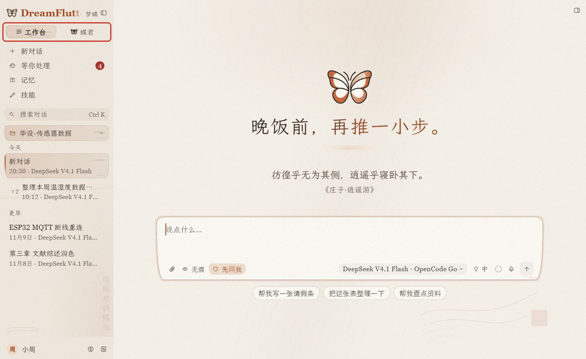

# 第 1 课　Agent 是什么

**学会：** 知道 DreamFlutter 能帮你做什么，工作台和蝶君有什么不同。**大约 3 分钟。**

## 它不只是聊天

普通的聊天机器人只会回答问题。DreamFlutter 是一个会**动手**的助手（这类助手叫 Agent）：它能读写你电脑上的文件、运行程序、上网查资料，把一件事从头做到尾。

比如你说「把这张销售表里重复的行删掉，按月汇总」，它会自己打开表格、写处理的程序、运行、检查结果，最后交给你一张新表。

## 两种用法：工作台和蝶君

左上角有「工作台」和「蝶君」两个按钮，对应两种用法：

| | 工作台 | 蝶君 |
|---|---|---|
| 你在不在旁边 | 在，看着它做 | 交代完就可以走开 |
| 能不能碰你的文件 | 能，改之前会先问你 | 不能，它在一个隔离的小系统里干活 |
| 适合 | 整理你手上的文件、写东西、改代码 | 查资料写报告、长期盯着一件事、定时做事 |

## 它需要一个「大脑」

做这些事要靠一个 AI 模型来思考。DreamFlutter 本身不带模型，要接上一个模型服务，下一课教你怎么接。

[下一课：接上一个模型 →](02-接上一个模型.md)
