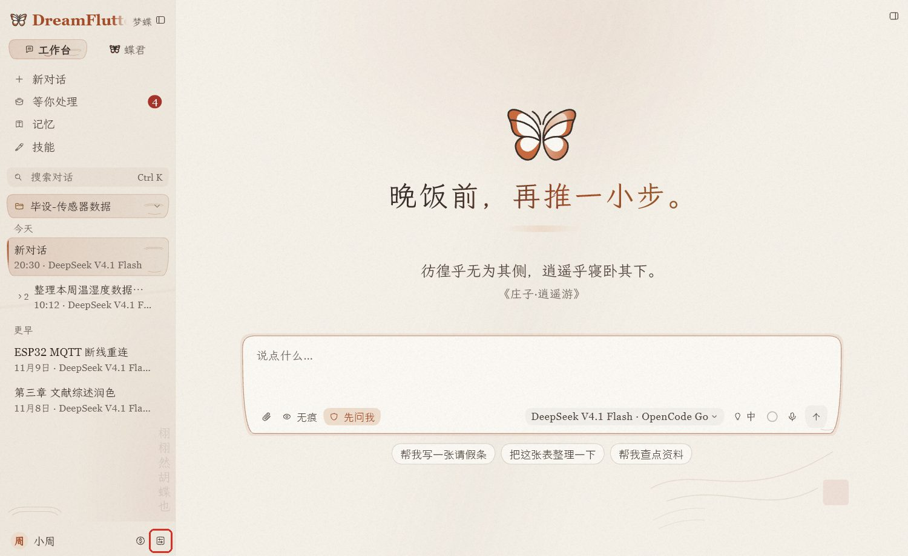
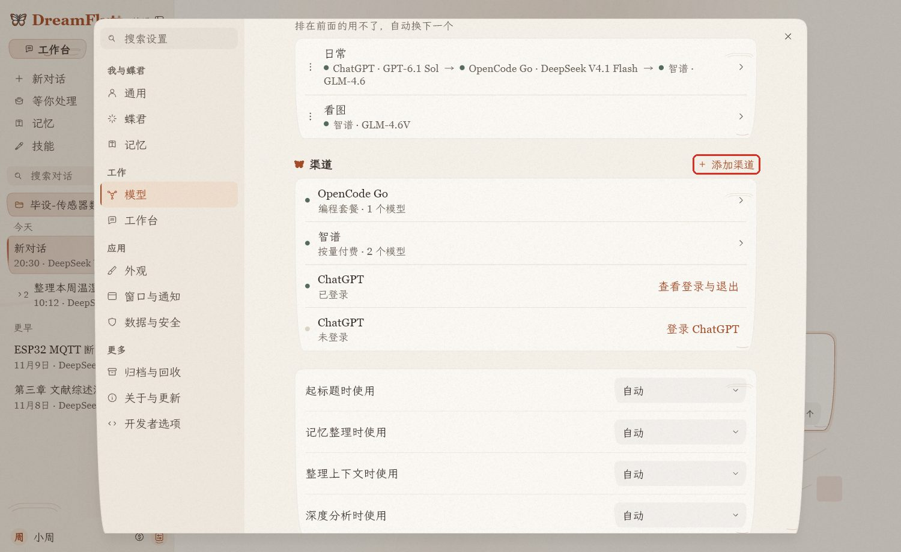
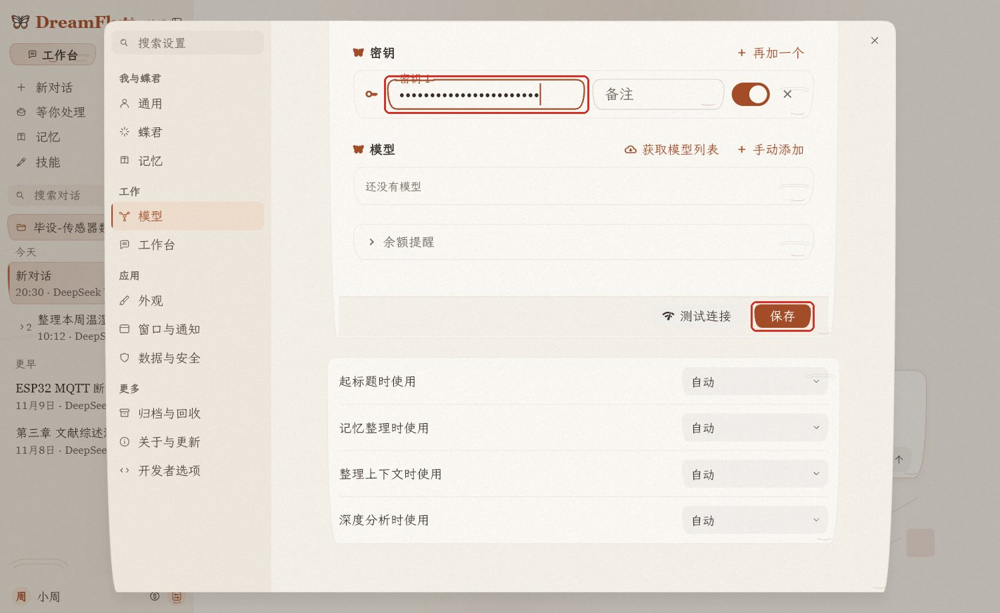

# 第 2 课　接上一个模型

**学会：** 拿到一个模型密钥，接进 DreamFlutter。**大约 10 分钟，需要充值 10 元左右。**

> 如果你在安装后的向导里已经接好了模型，这课可以跳过。

## 先弄懂两个词

- **模型**：帮你思考的 AI，比如 DeepSeek。它在模型公司的服务器上，按用量收费，一般一次对话几分钱。
- **密钥（Key）**：你在模型公司的账号凭证，像一把钥匙。DreamFlutter 用它代你去调用模型。**密钥不要发给别人。**

这里用 **DeepSeek** 举例：便宜，国内能直接用。

## 一、在 DeepSeek 网站上拿密钥

1. 打开 [platform.deepseek.com](https://platform.deepseek.com)，用手机号注册并登录。
   
2. 按页面提示完成实名认证。
3. 点左边「充值」，充 10 元就够用很久。
   
4. 点左边「API keys」，再点「创建 API key」，名字随便填，比如 DreamFlutter。
   
5. 弹出一串以 `sk-` 开头的字符，点「复制」。**这串字只显示这一次**，先粘到记事本里存好。
   

## 二、在 DreamFlutter 里接上

[带我去：设置 › 模型](go:settings/模型)

1. 点左下角的**齿轮**，打开设置。
   
2. 左边点「**模型**」，在「渠道」那一块点「**添加渠道**」。
   
3. 服务商选「**DeepSeek**」。
4. 把刚才复制的密钥粘贴到「密钥」框里。粘贴后程序会自动试一下能不能连上。
   
5. 看到「**连接成功**」后，点「保存」。

好了，以后每次对话都会用它。

## 常见问题

- **收不到短信验证码**：等一分钟再点「重新发送」，或换个浏览器。
- **显示「余额不足」**：回到 DeepSeek 网站充值。
- **显示「密钥不对」**：多半是复制时少了几个字或多了空格，重新复制一次再粘贴。
- **一直连不上**：检查网络；如果你用了代理，在 设置 › 工作台 › 网络 里填上。

[← 上一课](01-agent是什么.md)　[下一课：第一次对话 →](03-第一次对话.md)
