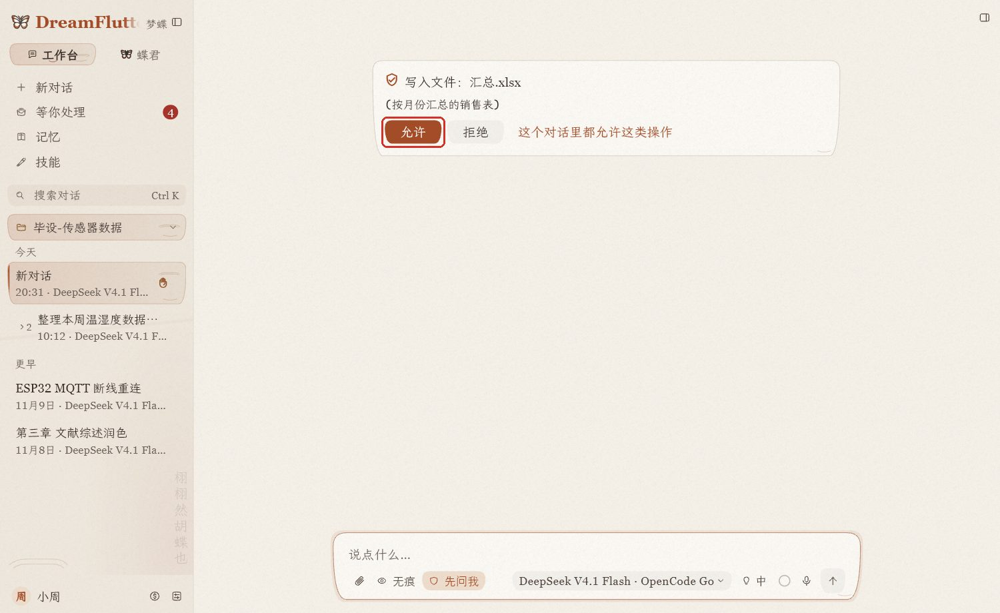
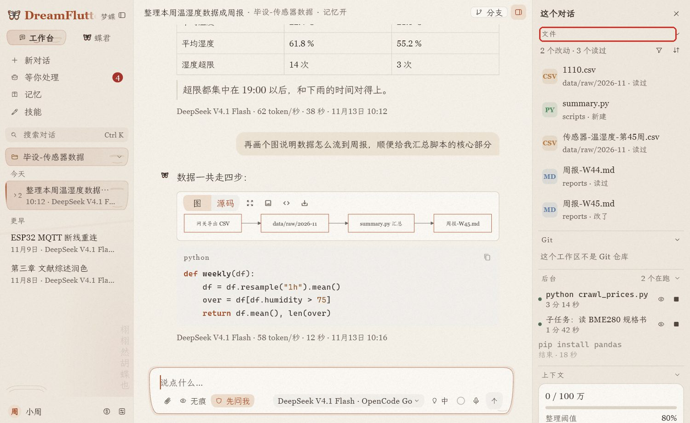

# 第 4 课　让它动手干活

**学会：** 让它处理文件夹里的文件，看懂「允许 / 拒绝」，看它改了什么。**大约 10 分钟，花几分钱。**

## 什么是「工作区」

工作区就是你允许它动的那个文件夹。它只在这个文件夹里读写，别的地方不碰。

程序给你准备了一个**练习文件夹**，里面有一张乱糟糟的销售表、几篇短文章和一张图片，随便它改，不会碰到你自己的文件。

## 1. 换到练习文件夹

[带我去：工作台](go:section/chat)

点左边栏里的**文件夹名字**（新对话下方那一栏），在弹出的「切换工作区」里选「**练习**」。

想用自己的文件夹时，点同一个菜单里的「**打开文件夹**」，选那个文件夹就行。

## 2. 看一眼「先问我」

输入框左下角有一个「**先问我**」。它的意思是：要改文件、运行程序之前，先停下来问你。**刚开始请一直开着。**

点一下会变成「直接做」：它就不再问你，直接动手。等你熟悉了、信得过它再用。

## 3. 让它干活

在输入框里发：

> 把 销售记录.xlsx 里重复的行删掉，日期统一成 年-月-日，按月份汇总成一张新表，存成 汇总.xlsx

## 4. 它会停下来问你

它准备写文件或运行程序时，对话里会出现一张卡片，写着它要做什么。看清楚后：

- 点「**允许**」：让它做。
- 点「**拒绝**」：不让它做。它会换个办法，或者问你想怎么办。

## 5. 看它改了什么

做完后，点窗口右上角的**侧栏按钮**，打开「这个对话」。「**文件**」里列出它读过、新建、改过的每个文件。点 `汇总.xlsx` 就能打开看。

## 小知识

- 它的每一步都写在回复上方那一行里（比如「读取 3 个文件 · 运行 1 条命令」），点开能看到细节。
- 改坏了也不怕：练习文件夹随时可以在 设置 › 关于与更新 › 使用说明 里重新准备一份。

[← 上一课](03-第一次对话.md)　[下一课：认识蝶君 →](05-认识蝶君.md)
