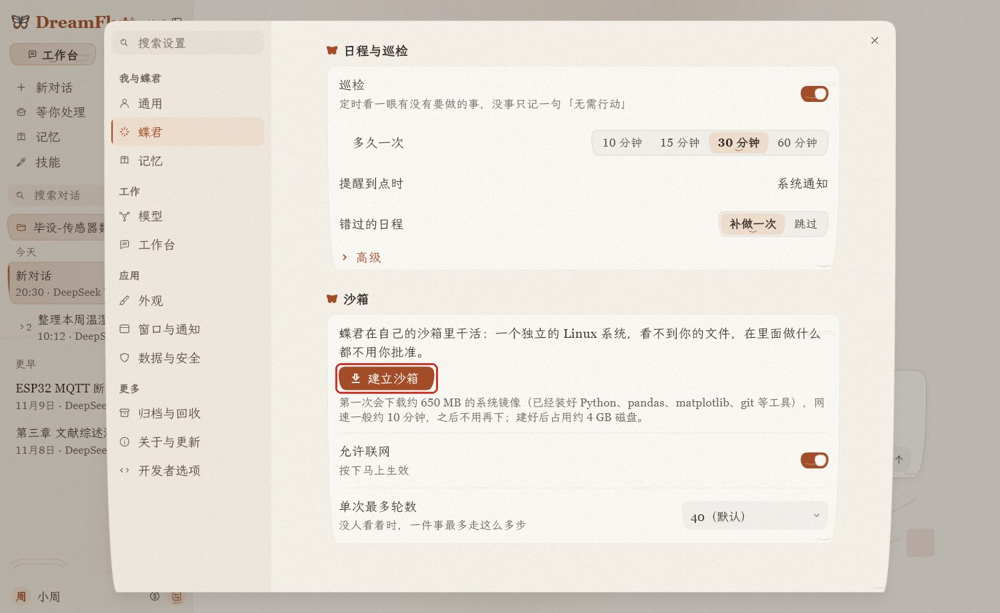
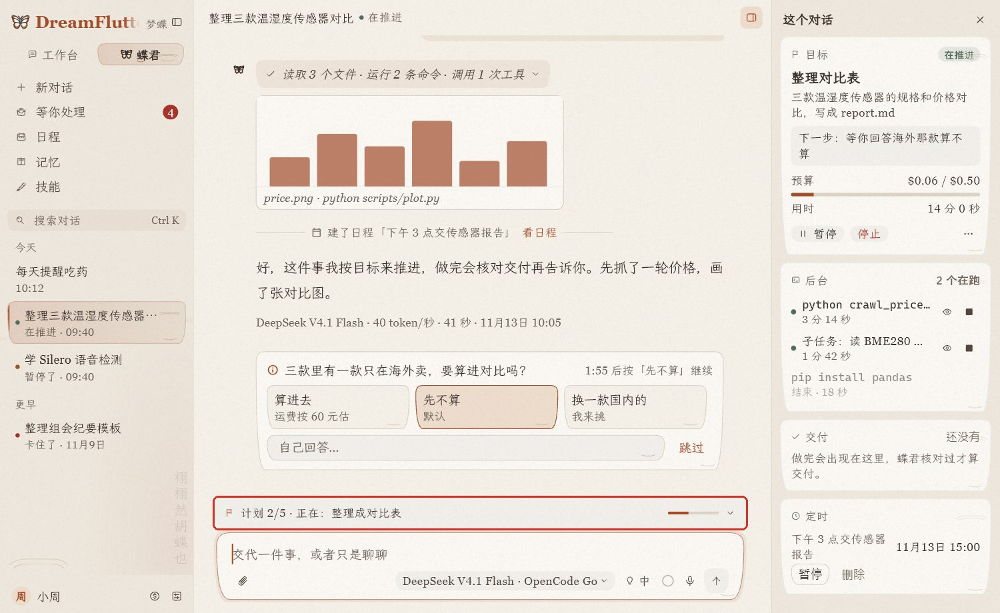
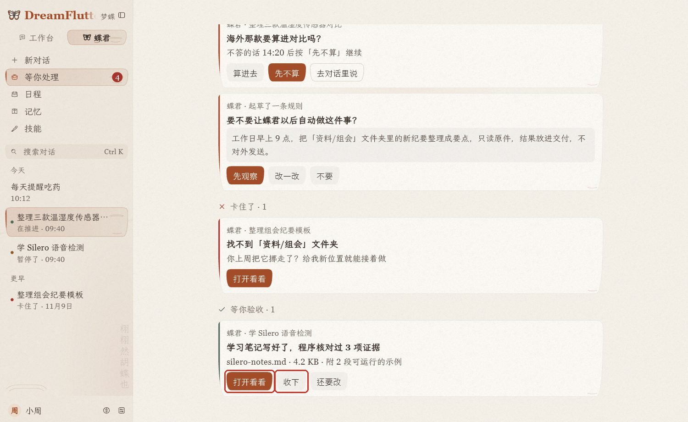

# 第 5 课　认识蝶君

**学会：** 建好蝶君的沙箱，交给它一件事，验收它的成果。**大约 15 分钟，建沙箱另算；练习任务大约花 0.1–0.3 元。**

## 蝶君是谁

蝶君是一个可以独立干活的助手。交代完你就可以走开，它自己列计划、查资料、写东西，做完会通知你。

它在自己的「**沙箱**」里干活：一个隔离的小 Linux 系统，看不到你电脑上的文件。所以它做事不用你一次次批准，也不会弄坏你的东西。

## 1. 切到蝶君

点左上角的「**蝶君**」。

## 2. 建好沙箱（只需要一次）

[带我去：设置 › 蝶君](go:settings/蝶君)

第一次用时会提示你建沙箱，点「**建立沙箱**」（也可以在 设置 › 蝶君 › 蝶君沙箱 里建）。

- 程序会先下载一个约 650 MB 的系统镜像，网速一般时大约 10 分钟，之后不用再下。
- 如果你的电脑还没有 WSL（Windows 自带的轻量虚拟机），会弹出 Windows 的**管理员确认**，点「**是**」，程序会帮你装好。
- 装 WSL 后多数电脑要**重启一次**。点「现在重启」或稍后自己重启都行；重启后程序会自己打开，接着把沙箱建完。

建沙箱时可以先去做别的。

## 3. 交给它一件事

沙箱好了以后，在蝶君的输入框里发：

> 帮我查一下今年国内新能源车销量前五的品牌，写一份一页的小报告

## 4. 让它自己做

它会先列个计划，然后自己去查、去写。窗口右边能看到：

- **目标**：它在做什么、下一步是什么。
- **预算**：这件事花了多少钱、上限多少。
- **后台**：它正在运行的程序。

这件事大约要 5–15 分钟，你可以去干别的。

## 5. 验收

[带我去：等你处理](go:section/tasks)

做完它会通知你。点左边栏的「**等你处理**」，在「等你验收」里找到这份报告：

- 「**打开看看**」：看报告。
- 「**收下**」：满意，这件事结束。
- 「**还要改**」：说说哪里不行，它接着改。

## 学完了

你已经会用 DreamFlutter 了。记忆、定时、技能、花费这些进阶内容，用到时再看后面几课。

[← 上一课](04-让它动手干活.md)　[进阶：它记住了什么 →](06-它记住了什么.md)
