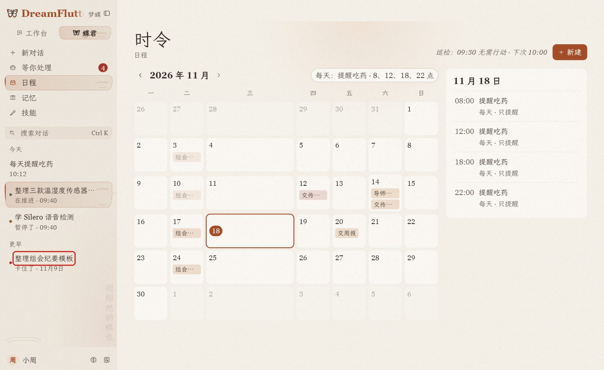

# 第 7 课　定时和长期目标

**学会：** 让蝶君定时做事，给它一个长期目标。

## 定时做事

在蝶君的对话里直接说，比如：

> 每天早上 8 点帮我整理一份科技新闻摘要

它会建一个日程，到点自己做，做完放进「等你处理」。

点左边栏的「**日程**」能看到所有日程：

[带我去：日程](go:section/schedules)

- **暂停**：先停一停，以后再开。
- **删除**：不要了。

也可以用大白话说时间，比如「下午 3 点提醒我开会」「30 分钟后看看那个下载好了没」。

## 长期目标

有的事不是一次能做完的，比如「帮我持续关注 SHT40 传感器的新资料」。给蝶君一个长期目标后，它空闲时会自己往前推，有进展或需要你决定时找你。

在 设置 › 蝶君 里可以：

- 「**长期目标**」：看和改它的长期目标；
- 「**主动性**」：选它主动的程度（多找你还是少打扰），以及它自己做事每天最多花多少钱；
- 「**夜间不打扰**」：晚上不来找你。

[← 上一课](06-它记住了什么.md)　[下一课：技能和常用说法 →](08-技能和常用说法.md)
